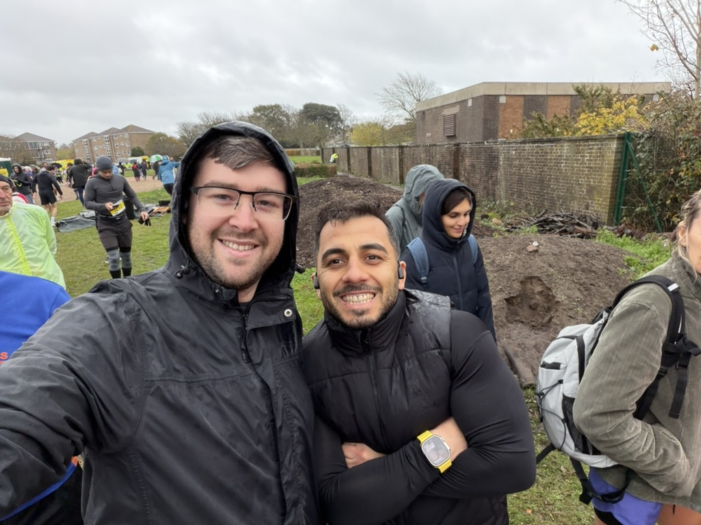
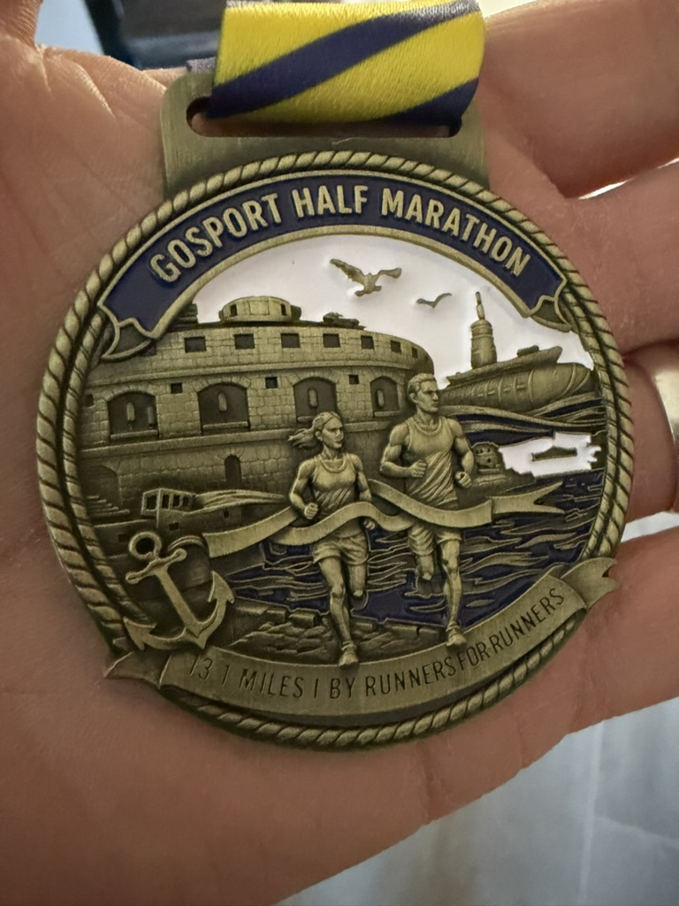

## Two lines, one finish

On Sunday I ran the Gosport Half Marathon with Emilian Cioata, who works with me at Radweb. We each ran our own race, at our own pace, and met at the finish.
I've been thinking about that since. It's a fairly good description of the kind of team I want to build.

## The race

The Gosport Half is two flat laps along the Lee-on-the-Solent seafront, looking out towards the Isle of Wight. It's organised by Gosport Road Runners, and the tagline on the medal sums it up: "by runners for runners". There's a samba band on the course, which helps more than you'd think at mile ten.

Sunday was grey and wet. We stood at the start in hoods and rain jackets, grinning like people who'd chosen this, which I suppose we had.

Emilian finished in 1:54:03. I finished in 2:30:18, a good 36 minutes later, which rather proves the point about running your own race. My preparation wasn't exactly textbook. We have a newborn at home, so training was patchy at best and sleep was something that happened to other people. I also learnt that I can't stand caffeine gels. They taste like coffee that's been left in the pot for a month. I got round anyway, and I'll take that.

The medal has a submarine on it and a sea fort, a lovely nod to the town's naval history.

## Why I'm writing about it on a tech blog

Nobody at Radweb asked Emilian or me to run a half-marathon. There was no team-building budget and no company T-shirt. Two colleagues fancied the same daft challenge and signed up.

I think that matters more than most things on a careers page. You can't put culture in a job ad. You see it in what people choose to do together when nobody's making them.

It also maps onto how I want the engineering team to work:

* Own pace, shared goal. We didn't run side by side, and we didn't need to. A good team doesn't need everyone moving at the same speed. It needs everyone pointed at the same finish.
* Turning up for each other. Waiting at the finish for someone is a small thing. So is a thoughtful code review or a quick "want a second pair of eyes?" on Slack. Small things add up.
* Consistency beats heroics. You don't get round 13.1 miles on a sprint. You get there on dull, steady weeks of training. Shipping good software is much the same.

## If that sounds like your kind of team

At Radweb we build Inventory Base and Property Inspect, software that letting agents, inventory clerks and surveyors use every day across the UK, US and South Africa. The engineering team is small enough that you know everyone, and that what you build gets used the following week.

You don't need to run, and you definitely don't need to enjoy standing in a wet field before 10am on a Sunday. But if you'd like to work somewhere people turn up for each other, I'm always happy to chat. Message me on LinkedIn, whether you're a graduate, a placement student or a senior developer, or have a look at our current roles on the [Radweb careers page](https://radweb.com/careers/).

And Emilian, same time next year?
